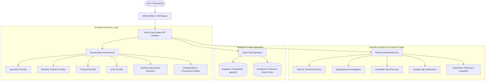

# PaperTrail Architecture

## System Overview
PaperTrail is an autonomous, evidence-driven research intelligence engine designed to discover hidden relationships between scientific findings, resolve apparent contradictions, falsify candidate research gaps with adversarial search, and produce testable, resource-evaluated experiments.

## Key Architectural Principles
1. **Multi-Provider Resilience**: Independent scholarly adapters for OpenAlex, Semantic Scholar, Crossref, arXiv, and TinyFish. The system operates gracefully even when third-party rate limits or network outages occur.
2. **Schema-Grounded Multi-Stage Reasoning**: Rather than asking an LLM to hallucinate research gaps in a single shot, PaperTrail breaks down the workflow into discrete stages (Discovery -> Claim Extraction -> Context Comparison -> Gap Synthesis -> Falsification Audit -> Experiment Planning), validating every stage with Zod schemas.
3. **Epistemic Integrity**: Distinguishes between what a paper proves, what context explains, and what remains an open candidate hypothesis.
4. **Adversarial Falsification**: Actively tries to disprove its own candidate gaps by searching for counter-evidence and overlapping prior work before proposing experiments.
