# PaperTrail Architecture — Evolving Scientific Intelligence

## System Overview
PaperTrail is an autonomous, continuously evolving scientific intelligence engine designed to discover what research has established, what it challenges, what remains unexplored, and how scientific evidence changes over time.

```mermaid
flowchart TD
    User([User / Researcher]) --> UI[Web Workspace & Timeline]
    UI --> API[Next.js App Router API Handlers]

    subgraph ContinuousTracking [Continuous Tracking & Discovery]
        API --> RDS[ResearchDiscoveryService]
        RDS --> OA[OpenAlex Provider]
        RDS --> S2[Semantic Scholar Provider]
        RDS --> CR[Crossref Provider]
        RDS --> AX[arXiv Provider]
        RDS --> TM[TinyMonitor & TinyFish Search]
        RDS --> DEDUP[Deduplication & Provenance Engine]
    end

    subgraph ScientificEvolution [Evolution & Lineage Engine]
        API --> EVO[EvolutionService]
        EVO --> LIN[PreprintLineageService]
        EVO --> RET[RetractionIntelligenceService]
        EVO --> DS[DatasetDiscoveryService]
        EVO --> CD[CrossDomainService]
    end

    subgraph AnalysisEngine [Evidence Investigation & Falsification]
        API --> RAS[ResearchAnalysisService]
        RAS --> CES[Claim & Context Extraction]
        RAS --> DIS[Disagreement Investigation]
        RAS --> RGS[Candidate Gap Discovery]
        RAS --> FALS[6-Stage Gap Falsification]
        RAS --> EXP[Experiment Planning & Feasibility]
    end

    subgraph DataStorage [Storage & Graph Subsystem]
        API --> REPO[PaperTrail Repository]
        REPO --> PG[(Supabase PostgreSQL / pgvector)]
        REPO --> MEM[(Persistent In-Memory / Cache Store)]
    end
```

## Core Architectural Pillars

### 1. Continuous Evolution & Tracking
- **TinyMonitor & Scheduled Polling**: Actively monitors topic queries, preprints, and lab publications.
- **Evidence Evolution Delta**: When new research is ingested, PaperTrail isolates the exact delta: new claims extracted, existing claims supported or challenged, candidate gaps narrowed or falsified, and a narrative summary recorded in the evolution timeline.

### 2. Preprint-to-Publication Lineage
- **Lineage Matching**: Maps arXiv preprints to their eventual peer-reviewed conference or journal releases based on token similarity, author set overlap, and DOI resolution.
- **Version Differentiation**: Isolates shifts in benchmark evaluation, sample size, or methodology without prematurely merging distinct version records.

### 3. Retraction and Correction Intelligence
- **Provenance Preservation**: Retracted or corrected papers are never silently deleted.
- **Impact Propagation**: Flagging a retracted paper automatically tags dependent claims, generates provenance warning banners, and triggers re-evaluation of affected research gaps.

### 4. Accessible Dataset Discovery
- **Multi-Repository Search**: Queries Hugging Face Datasets, Zenodo, and Figshare for benchmark datasets.
- **License & Availability Verification**: Confirms access URLs and licenses before linking datasets to research claims.

### 5. Cross-Domain Hypothesis Transfer
- **Interdisciplinary Analogies**: Connects Edge AI phenomena (e.g. activation sparsity, DVFS thermal throttling) with adjacent sciences (neuromorphic sparse spike coding, OS thermal headroom management).
- **Hypothesis Labeling**: Explicitly classifies cross-domain connections as candidate hypotheses rather than established scientific facts.
